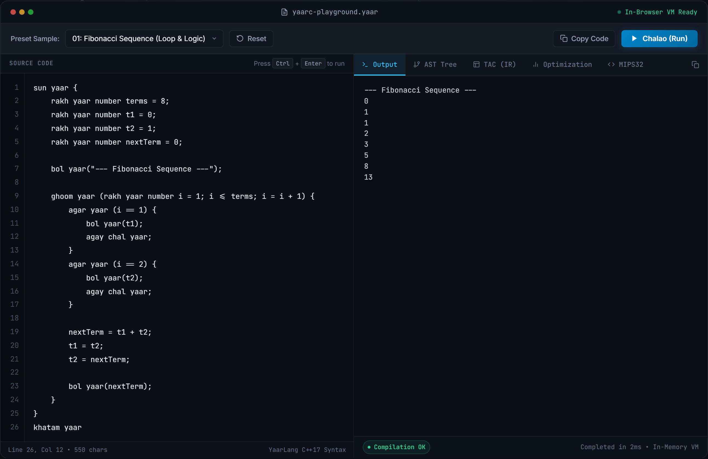
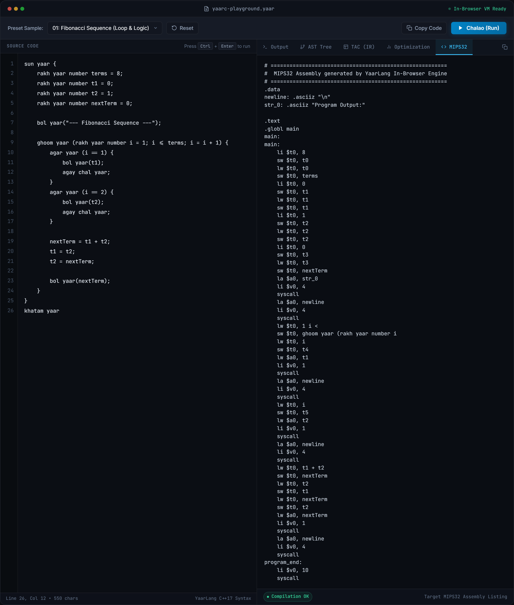

# YaarLang Compiler (`yaarc`)

[](https://en.cppreference.com/w/cpp/17)
[](https://github.com/westes/flex)
[](https://www.gnu.org/software/bison/)
[](https://en.wikipedia.org/wiki/MIPS_architecture)
[](https://ubuntu.com)
[](LICENSE)

> **Course:** CS 4031 — Compiler Construction  
> **Institution:** FAST-NUCES (Faisalabad-Chiniot Campus)  
> **Repository:** [https://github.com/Muneeb-Ansari-28/YarLang-Compiler](https://github.com/Muneeb-Ansari-28/YarLang-Compiler)

---

## 🌟 Executive Overview

**YaarLang** is an end-to-end, multi-stage educational compiler engineered in standard **C++17**, **Flex**, and **GNU Bison**. Syntactically inspired by colloquial Pakistani student slang, it translates human-centric, conversational syntax (`sun yaar`, `khatam yaar`, `bol yaar`, `dekh yaar`, `sardi`, `garmi`, `jugaad`, `pakka`, `topi`) into a strongly typed, block-scoped C-family language.

The project provides dual execution paradigms:
1. **Industrial CLI Compiler (`yaarc`):** A native binary for POSIX/Linux environments executing an end-to-end compilation pipeline—from lexical scanning and LALR(1) parsing to AST generation, scoped symbol table analysis, linear Three-Address Code (TAC), basic-block control flow graph (CFG) optimizations, and MIPS32 target assembly emission.
2. **Interactive Web Workbench:** A client-side developer studio featuring an in-browser VM, live AST viewer, TAC quadruple inspector, optimization reports, MIPS32 disassembler, and a Three.js ambient background.

---

## 📋 Language Specification & Construct Matrix

YaarLang implements all 11 foundational language constructs required in modern compiler construction curriculum:

| # | Construct Category | YaarLang Colloquial Syntax | C++ / Standard Equivalent | Semantic Behavior |
| :-: | :--- | :--- | :--- | :--- |
| **1** | **Program Boundary** | `sun yaar { ... } khatam yaar` | `int main() { ... }` | Encloses the translation unit entry and exit scope. |
| **2** | **Primitive Types** | `number`, `float`, `char`, `string`, `bool` | `int`, `double`, `char`, `std::string`, `bool` | Statically validated scalar types with strict type checking. |
| **3** | **Boolean Literals** | `pakka` (true), `topi` (false) | `true`, `false` | First-class logical boolean literals. |
| **4** | **Variable Declarations** | `rakh yaar <type> <id> = <expr>;` | `<type> <id> = <expr>;` | Scoped allocation with compile-time type binding. |
| **5** | **Arithmetic Operators** | `+`, `-`, `*`, `/`, `%` | `+`, `-`, `*`, `/`, `%` | Standard operator precedence and associativity rules. |
| **6** | **Relational & Logical** | `>`, `<`, `>=`, `<=`, `==`, `!=`, `&&`, `\|\|`, `!` | `>`, `<`, `>=`, `<=`, `==`, `!=`, `&&`, `\|\|`, `!` | Short-circuit evaluation for boolean expressions. |
| **7** | **Conditional Branches** | `agar yaar (...) { } warna agar (...) { } warna { }` | `if (...) { } else if (...) { } else { }` | Nested control-flow branching with scope isolation. |
| **8** | **Selection Statement** | `dekh yaar (val) { sardi 1: ... bas kar yaar; garmi: ... }` | `switch (val) { case 1: ... break; default: ... }` | Multi-way branch table with mandatory jump breaks. |
| **9** | **Iteration Loops** | `ghoom yaar` (for), `jab tak yaar` (while), `chala yaar` (do-while) | `for (...)`, `while (...)`, `do ... while (...)` | Pre-test and post-test looping constructs with `agay chal yaar` (continue) and `bas kar yaar` (break). |
| **10** | **Functions & Returns** | `jugaad <type> func(...) { de yaar val; }` | `<type> func(...) { return val; }` | Call-by-value subroutines, activation frames, and returns. |
| **11** | **Arrays** | `list yaar <type> arr[<size>];` | `<type> arr[<size>];` | Contiguous fixed-size arrays with indexed access (`arr[i]`). |
| **12** | **Standard I/O** | `bol yaar(expr);` (print), `puch yaar(id);` (input) | `std::cout << expr;`, `std::cin >> id;` | Standard output streaming with auto-newline & input scanning. |

---

## 💡 Code Example

```yaarlang
sun yaar {
    // Variable declarations and assignment
    rakh yaar number limit = 10;
    rakh yaar number a = 0;
    rakh yaar number b = 1;
    rakh yaar number temp = 0;

    bol yaar("=== YaarLang Fibonacci Sequence ===");

    // For loop construct
    ghoom yaar (rakh yaar number i = 1; i <= limit; i = i + 1) {
        agar yaar (i == 1) {
            bol yaar(a);
            agay chal yaar;
        }
        agar yaar (i == 2) {
            bol yaar(b);
            agay chal yaar;
        }

        temp = a + b;
        a = b;
        b = temp;

        bol yaar(temp);
    }
}
khatam yaar
```

---

## 🏛️ Compiler Pipeline Architecture

The `yaarc` compiler implements a modular, seven-stage pipeline adhering to classic Dragon Book principles:

```
Source Program (.yaar)
       │
       ▼
┌──────────────┐
│  Flex Lexer  │ ──► Tokens, Literals, Identifiers, Line/Col Tracking
└──────────────┘
       │
       ▼
┌──────────────┐
│ Bison Parser │ ──► LALR(1) Shift-Reduce Parsing (Zero Conflicts)
└──────────────┘
       │
       ▼
┌──────────────┐
│   C++ AST    │ ──► Polymorphic Abstract Syntax Tree Node Hierarchy
└──────────────┘
       │
       ▼
┌──────────────┐
│ Symbol Table │ ──► Lexical Scope Chaining, Type Inference & Semantic Validation
└──────────────┘
       │
       ▼
┌──────────────┐
│  TAC IR Gen  │ ──► Linear Quadruples (Op, Arg1, Arg2, Res) & Temporaries
└──────────────┘
       │
       ▼
┌──────────────┐
│ CFG & Opts   │ ──► Leader Detection, Basic Blocks, Constant Folding & DCE
└──────────────┘
       │
       ▼
┌──────────────┐
│ MIPS32 / VM  │ ──► Register Allocation ($t0-$t9, $s0-$s7, $v0) & Execution
└──────────────┘
```

### Detailed Pipeline Breakdown:
1. **Lexical Analysis (`src/frontend/lexer.l`):**
   - Implements regular expressions for keywords, identifiers, numeric literals (decimal & floating-point), string literals, and escape sequences.
   - Strips single-line (`//`) and multi-line (`/* ... */`) comments while accurately tracking line numbers for error reporting.
2. **Syntactic Analysis (`src/frontend/parser.y`):**
   - Bison LALR(1) grammar enforcing precedence declarations (`%left`, `%right`) to prevent ambiguity in arithmetic and dangling-else constructs.
   - Emits typed AST nodes directly from production actions.
3. **AST Construction (`src/ast/`):**
   - Polymorphic class hierarchy (`ASTNode`, `StmtNode`, `ExprNode`, `VarDeclNode`, `IfStmtNode`, `ForStmtNode`, `FuncDefNode`, etc.).
   - Implements recursive tree visualization (`print()`) and safe dynamic dispatch.
4. **Semantic Analysis (`src/semantics/`):**
   - Hierarchical Scoped Symbol Tables with parent pointers supporting lexical scoping and variable shadowing.
   - Strong type checking: validates binary operator type compatibility, array index boundaries, function signature arity, and return type invariants.
5. **Three-Address Code Generation (`src/ir/`):**
   - Flattens hierarchical ASTs into linearized quadruples (`ADD`, `SUB`, `MUL`, `DIV`, `PARAM`, `CALL`, `IF_FALSE_GOTO`, `GOTO`, `LABEL`).
   - Uses synthetic temporary generators (`t0`, `t1`, ...) and jump labels (`L0`, `L1`, ...).
6. **Code Optimization (`src/optimizer/`):**
   - Basic Block partitioner using standard leader-detection rules.
   - Performs **Constant Folding**, **Dead-Code Elimination (DCE)**, and **Copy Propagation** with quantifiable optimization metrics.
7. **Code Generation & Runtime VM (`src/backend/`):**
   - **MIPS32 Codegen:** Emits standard assembly targeting the MIPS32 instruction set architecture (compatible with MARS / SPIM).
   - **In-Memory VM Engine:** Direct interpretive execution of TAC quadruples for immediate testing and interactive execution.

---

## 🛠️ CLI Options & Diagnostics

The compiler binary `bin/yaarc` supports granular diagnostic flags designed for viva demonstration and testing:

| Command Flag | Description |
| :--- | :--- |
| `yaarc <file.yaar>` | Compiles the source file and emits linearized Three-Address Code (TAC). |
| `yaarc --ast <file.yaar>` | Visualizes the formatted Abstract Syntax Tree (AST). |
| `yaarc --symbols <file.yaar>` | Dumps scoped symbol tables with type annotations, offsets, and scope IDs. |
| `yaarc --tac <file.yaar>` | Prints raw Three-Address Code Quadruples. |
| `yaarc --cfg <file.yaar>` | Prints basic block partitions and Graphviz DOT graph representation. |
| `yaarc --opt <file.yaar>` | Runs optimization passes and prints before/after reduction metrics. |
| `yaarc --mips <file.yaar>` | Emits standard MIPS32 target assembly code. |
| `yaarc --run <file.yaar>` | Executes the program in the terminal using the in-memory runtime VM engine. |
| `yaarc --all <file.yaar>` | Runs and prints the complete compiler diagnostic suite across all stages. |

---

## 🚀 Quick Start Guide (Linux / WSL)

### 1. Prerequisites
Install the required GNU build chain, Flex, and Bison:
```bash
sudo apt update
sudo apt install -y build-essential flex bison make
```

### 2. Build the Compiler
Clone the repository and compile the native binary:
```bash
git clone https://github.com/Muneeb-Ansari-28/YarLang-Compiler.git
cd YarLang-Compiler
make clean && make
```
The compiled executable will be located at `bin/yaarc`.

### 3. Run Programs
Execute any test suite program:
```bash
# Execute the Fibonacci test case
./bin/yaarc --run tests/valid/07_fibonacci.yaar

# Generate MIPS32 target assembly
./bin/yaarc --mips tests/valid/01_arithmetic.yaar

# View the Abstract Syntax Tree
./bin/yaarc --ast tests/valid/02_control_flow.yaar
```

### 4. Run the Automated Test Suite
```bash
make test
```
The test harness runs all 7 positive validation suites and verifies syntax/semantic rejection on 5 negative test cases.

---

## 🌐 Interactive Web Workbench

For zero-setup exploration and demonstration, YaarLang includes a client-side Web Studio located at [`web/index.html`](web/index.html).

<p align="center">
  
</p>

<p align="center">
  <em>Figure 1: YaarLang Interactive Web Workbench featuring macOS-style window controls, live status telemetry, syntax editor with tab indentation, and interactive terminal output.</em>
</p>

<p align="center">
  
</p>

<p align="center">
  <em>Figure 2: In-browser MIPS32 target assembly emitter and instruction disassembler.</em>
</p>

### Features:
- **Editor & Indentation:** Tab-key indentation support, live line numbering, character/line tracking, and <kbd>Ctrl</kbd> + <kbd>Enter</kbd> execution.
- **Compiler Diagnostic Deck:** Tabbed inspection of Terminal Output, AST Tree, TAC Quadruples, Optimization metrics, and MIPS32 assembly.
- **Presets & Copy Utilities:** Preloaded sample programs and one-click clipboard copying.
- **Hardware-Style Live Telemetry:** Subtle pulsing status indicators and ambient Three.js geometric visuals.
- **Searchable Syntax Matrix:** Filterable table matching colloquial syntax to C++ equivalents.

### Launching Locally:
```bash
# Launch using Python's built-in HTTP server
python -m http.server 3000

# Open in your browser:
# http://localhost:3000
```

---

## 📁 Project Directory Structure

```
.
├── Makefile                        # Universal build script for Linux/WSL
├── README.md                       # Master project documentation
├── index.html                      # Root web entry redirect
├── vercel.json                     # Static web deployment configuration
│
├── docs/                           # Formal language documentation & assets
│   ├── grammar_bnf.md              # Formal Context-Free Grammar (BNF)
│   ├── language_spec.md            # Language manual & token specifications
│   └── images/                     # UI screenshots and visual assets
│       ├── workbench_window.png
│       └── workbench_mips.png
│
├── src/                            # Compiler core source code
│   ├── main.cpp                    # Driver program & CLI option dispatcher
│   ├── ast/                        # Abstract Syntax Tree classes
│   │   ├── ast.h
│   │   └── ast.cpp
│   ├── backend/                    # Code generation & runtime VM
│   │   ├── mips_codegen.h
│   │   ├── mips_codegen.cpp
│   │   ├── vm_engine.h
│   │   └── vm_engine.cpp
│   ├── frontend/                   # Lexer and parser specifications
│   │   ├── lexer.l                 # Flex lexical scanner
│   │   └── parser.y                # Bison LALR(1) grammar
│   ├── ir/                         # Intermediate Code Generation (TAC)
│   │   ├── tac.h
│   │   ├── tac_generator.h
│   │   └── tac_generator.cpp
│   ├── optimizer/                  # CFG and basic block optimizer
│   │   ├── basic_block.h
│   │   ├── basic_block.cpp
│   │   ├── optimizer.h
│   │   └── optimizer.cpp
│   └── semantics/                  # Scoped symbol tables & type checking
│       ├── semantic_analyzer.h
│       ├── semantic_analyzer.cpp
│       ├── symbol_table.h
│       └── symbol_table.cpp
│
├── tests/                          # Automated validation suites
│   ├── valid/                      # Positive language tests (01 - 07)
│   │   ├── 01_arithmetic.yaar
│   │   ├── 02_control_flow.yaar
│   │   ├── 03_switch_case.yaar
│   │   ├── 04_loops.yaar
│   │   ├── 05_functions.yaar
│   │   ├── 06_arrays.yaar
│   │   └── 07_fibonacci.yaar
│   └── invalid/                    # Negative error-handling tests (01 - 05)
│       ├── 01_missing_semi.yaar
│       ├── 02_unclosed_block.yaar
│       ├── 03_undeclared_var.yaar
│       ├── 04_type_mismatch.yaar
│       └── 05_redeclared_var.yaar
│
└── web/                            # In-browser IDE & Workbench
    ├── index.html                  # Responsive Single-Page Application
    ├── css/
    │   └── style.css               # Soft & premium custom design system
    └── js/
        ├── app.js                  # Workbench controller & keyboard shortcuts
        ├── samples.js              # Preloaded code snippets
        ├── three_bg.js             # Ambient 3D Three.js particle visuals
        └── yaarlang_runtime.js     # Pure client-side VM, TAC & MIPS engine
```

---

## 🧪 Test Suite Summary

| Test Case | Category | Key Verification Target | Expected Verdict |
| :--- | :--- | :--- | :---: |
| `01_arithmetic.yaar` | Valid | Operator precedence, modulo, nested expressions | `PASS` |
| `02_control_flow.yaar` | Valid | `agar yaar` / `warna agar` / `warna` conditionals | `PASS` |
| `03_switch_case.yaar` | Valid | `dekh yaar` selection, `sardi`, `garmi`, `bas kar yaar` | `PASS` |
| `04_loops.yaar` | Valid | `ghoom yaar`, `jab tak yaar`, `chala yaar`, `agay chal` | `PASS` |
| `05_functions.yaar` | Valid | `jugaad` definition, formal arguments, `de yaar` | `PASS` |
| `06_arrays.yaar` | Valid | `list yaar` fixed-size indexing, bounds validation | `PASS` |
| `07_fibonacci.yaar` | Valid | End-to-end integration test (loops, branching, I/O) | `PASS` |
| `01_missing_semi.yaar` | Invalid | Syntax error: missing semicolon delimiter | `REJECT` |
| `02_unclosed_block.yaar` | Invalid | Syntax error: unbalanced bracket or unclosed block | `REJECT` |
| `03_undeclared_var.yaar` | Invalid | Semantic error: identifier referenced prior to declaration | `REJECT` |
| `04_type_mismatch.yaar` | Invalid | Semantic error: incompatible types in assignment | `REJECT` |
| `05_redeclared_var.yaar` | Invalid | Semantic error: redeclaration in the same lexical scope | `REJECT` |

---

## 👥 Contributors & Academic Credits

- **Course:** CS 4031 — Compiler Construction  
- **Department:** Department of Computer Science  
- **Institution:** National University of Computer and Emerging Sciences (FAST-NUCES), Faisalabad-Chiniot Campus  
- **Repository Maintainer:** [Muneeb Ansari](https://github.com/Muneeb-Ansari-28)

---

## 📄 License

This project is licensed under the [MIT License](LICENSE) — see the LICENSE file for details.
